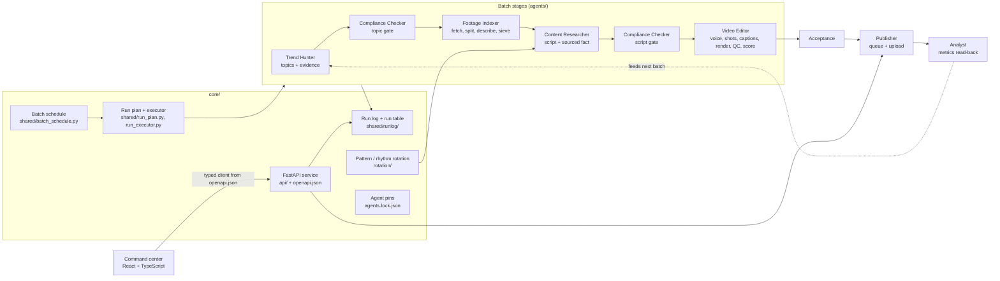

# Shorts Content Factory

An automated pipeline that turns the week's news into finished vertical short videos: it finds topics, screens them, gathers and indexes footage, writes scripts, edits and renders the video, queues it for publishing and reads the results back to improve the next batch. The code is organised as a small set of cooperating agents (each one an independent project with its own tests) driven by a Python orchestration layer, a FastAPI service and a React web UI.

> **This is a curated snapshot of a private project, not a turnkey product.** It was cleaned for publication: channel configurations, run history, analytics, media, credentials and anything tied to a real account were removed or replaced by neutral `example-film` / `example-tech` placeholders, and tests that depended on removed fixtures were dropped. It is published to show how the system is designed and built. Not everything in it runs out of the box (see [Layout of this snapshot](#layout-of-this-snapshot)), and the test suites were not re-run after the cleaning.

## Contents

- [Architecture](#architecture)
- [Layout of this snapshot](#layout-of-this-snapshot)
- [The agents](#the-agents)
- [Orchestration layer (`core/`)](#orchestration-layer-core)
- [Command center (`command-center/`)](#command-center-command-center)
- [Tech stack](#tech-stack)
- [Engineering highlights](#engineering-highlights)
- [Size and tests](#size-and-tests)
- [License](#license)

## Architecture

A batch is one pass of a channel's run plan. The plan is data (`run_plan` in the channel config), validated by one reader and walked by an executor that launches each stage, waits for it, writes a marker and moves on. The LLM operator supplies judgement inside a stage; the waiting, the memory of where a run stands and the contracts between stages are mechanical.



Each stage reads the previous stage's files and writes its own; stage contracts (file shapes, required fields, refusal reasons) are enforced in code, not only in prose.

## Layout of this snapshot

```
core/             orchestration layer, FastAPI service, shared libraries, rotation,
                  root-level tests, the publisher and analyst agents (core/agents/)
agents/           five independent agent projects (trend-hunter, compliance-checker,
                  footage-indexer, content-researcher, video-editor)
command-center/   the web UI
```

In the original project the agents are checked out under `<root>/agents/<name>` and the root locates them there; here they sit next to `core/` instead. To run anything that crosses the boundary, set `FACTORY_ROOT=core` and symlink the agents into the root, for example `ln -s ../../agents/video-editor core/agents/video-editor` for each agent. Channel configs are reduced to two minimal examples (`core/channels/example-film.json`, `example-tech.json`). There is no media, no footage pool and no run history, so the full pipeline cannot be replayed from this repository alone. `.env.example` lists the variables the code reads; credentials are never part of the code.

## The agents

Each agent is a Claude Code project: one skill (`.claude/skills/<name>/SKILL.md`) for the judgement-heavy steps plus Python scripts for everything that must be reproducible, with its own README and test suite.

| Agent | Role | Notes |
| --- | --- | --- |
| **Trend Hunter** (`agents/trend-hunter`) | Finds what is popular this week from RSS feeds and the YouTube Data API, checks that each topic has a checkable fact and usable footage, writes the shortlist. | Evidence lookups through public reference APIs; a candidate pool and a "fact rule" predicate shared with the root. |
| **Compliance Checker** (`agents/compliance-checker`) | A first-pass screen over every shortlisted topic and every written script before the next stage spends work on it. | Heuristic, not legal advice; every file it writes says so. Verdicts come from scripts so they are reproducible. |
| **Footage Indexer** (`agents/footage-indexer`) | Fetches source videos for each topic, splits them into shots, describes and sieves them, and keeps the shared shot pool. | Fingerprinting, sharpness and usability measurements, caption caching, licence gating, a pool that scripts are written against. |
| **Content Researcher** (`agents/content-researcher`) | Writes one script per topic: one story retold, warmed with one concrete sourced fact the story does not carry. | Scripts are held to the channel's contracts by scripts; claim checks against sources. |
| **Video Editor** (`agents/video-editor`) | Turns a checked script into a finished 9:16 video: narration, word timings, a shot under every phrase, captions, inserts, music, render, quality checks, a score. | Python pipeline in `scripts/` plus a Remotion project in `render/`; FFmpeg throughout; smart crop and face-window logic; a render-plan checker that refuses bad plans. |
| **Publisher** (`core/agents/publisher`) | Queues finished videos into dated slots and uploads them through the YouTube Data API with OAuth. | Upload gate, one-time authorisation flow, refuses secrets inside a git working tree, test/production OAuth modes. |
| **Analyst** (`core/agents/analyst`) | Reads performance back (API metrics and a scheduled read of the creator dashboard) and turns it into summaries and a wanted-footage list for the next batch. | Metrics store, summary generator, wanted-footage hints. |

## Orchestration layer (`core/`)

- **Run plan and executor** (`shared/run_plan.py`, `shared/run_executor.py`): the stage graph of a channel as data, one validating reader, one executor with resumable state.
- **Batch schedule** (`shared/batch_schedule.py`): one batch a day for the whole factory, a tick that starts it, and a switch that lets the schedule run unattended (launchd templates in `scripts/launchd/`).
- **Run log** (`shared/runlog/`, `scripts/runlog`): an append-only event log of every batch, rendered into a runs table; usage and limit monitors, a watchdog, funnel and triage views.
- **Rotation** (`rotation/`): assigns a (pattern, rhythm) pair per script from a ledger so that consecutive videos differ in structure, with a guard at the point of assignment (`patterns/` holds the pattern definitions).
- **Agent pins** (`agents.lock.json`, `shared/agents_lock.py`, `scripts/agents`): the agents behave like libraries of the root and are pinned like `package.json` dependencies; a release branch pins what a version is built on, so work on an agent never reaches a running batch.
- **Shared libraries** (`shared/`): the fact rule, source policy (robots.txt checks), licence handling for footage, scoring, process-group killing, timeout and no-network guards, a journal of questions to a human operator, notification backends.
- **FastAPI service** (`api/`, `api/openapi.json`): the read/write surface for the UI — channels, batches, videos, pool, publish queue, analytics, settings — with an exported OpenAPI contract.

## Command center (`command-center/`)

A single-page web UI over the API: channels and their configuration (with a JSON editor), batches and the day plan, video acceptance, the publish queue, statistics, an analyst view and a journal of questions. Types are generated from the API's OpenAPI document (`api:types`) and a check (`api:check`) fails the type-check if the committed snapshot drifts from the contract. Unit tests run on Vitest with MSW mocks; end-to-end tests use Playwright. A demo mode ships placeholder media (`tests/e2e/assets/`, generated gradients and a test pattern). The module's own README is in Russian.

## Tech stack

Read from the dependency files in this repository:

- **Python** orchestration and agents; the root suite and agent runners are plain-script runners rather than pytest.
- **API**: FastAPI 0.128, uvicorn 0.39, httpx 0.28 (in-process `TestClient` tests), Pillow 11.
- **Footage Indexer / Trend Hunter / Video Editor**: PyTorch 2.2, Hugging Face Transformers 4.44 (with CLIP-style embeddings), NumPy < 2, Pillow, yt-dlp, requests, feedparser, Kokoro TTS, soundfile.
- **Rendering**: Remotion 4 (React 18) driven from Python, FFmpeg.
- **Command center**: React 19, TypeScript, Vite, React Router 8, TanStack Query 5, Tailwind CSS 4, Radix UI primitives, CodeMirror 6, openapi-fetch / openapi-typescript; Vitest, Testing Library, MSW, Playwright, ESLint, Prettier.
- **Platform**: macOS launchd for scheduling, git for pins, hooks and journals, Claude Code skills for LLM stages.

## Engineering highlights

- **Pipeline as data.** The stage graph, ordering, arguments, dependencies and contracts of a channel live in one validated structure instead of prose and operator habit.
- **Mechanical guards around LLM stages.** An LLM stage cannot silently change tracked code: the executor snapshots the working tree and refuses a run whose code no longer matches the pinned revisions (`shared/stage_code_guard.py`). Subprocesses must carry a timeout ceiling, enforced by an AST-scanning test shared by every repository (`shared/timeout_guard.py`); whole process groups are killed and waited on (`shared/proc_group.py`).
- **Tests that cannot touch live data.** A shared hygiene layer turns the network off for the suites and bans reads of live pipeline and footage directories; runners fail loudly unless a file both exits 0 and prints a complete `N/N passed` summary.
- **Pinned agents with release branches.** Agents are versioned libraries of the root, pinned in `agents.lock.json` and synced into git worktrees, so development of the next version never disturbs a running batch.
- **Contract-first API and UI.** The OpenAPI document is exported from the FastAPI app, the UI's client types are generated from it, and drift fails the build.
- **Defensive publishing.** Upload is gated, the channel behind a token is compared with the expected channel before every upload, and credential files are refused inside a git working tree.
- **Resumable, observable runs.** Every batch writes an append-only event log; the run table, funnel, triage and gap views are derived from it, and the executor resumes from its state file.
- **A human-question journal.** Anything that needs the operator becomes a row in a journal that scripts, the API and the UI all read, with answered/resolved state.

## Size and tests

Counts are static (`def test_` in `test_*.py` files, and `it(` / `test(` calls in TypeScript test files) taken from the original, uncleaned repositories at the time of the snapshot; a parametrised or looped test counts once. Commit counts are `git rev-list --count HEAD` of each original repository.

| Original repository | Commits | Test definitions |
| --- | ---: | ---: |
| Root (orchestration, API, publisher, analyst) | 4533 | 4390 |
| trend-hunter | 304 | 1117 |
| compliance-checker | 85 | 300 |
| footage-indexer | 291 | 939 |
| content-researcher | 392 | 1506 |
| video-editor | 836 | 2237 |
| command center (frontend) | 1063 | 1886 (1233 unit, 653 end-to-end) |

This snapshot keeps the tests whose fixtures survived the cleaning: 5413 Python test definitions and 1622 TypeScript test calls. It is a single commit; the history of the original repositories is not included.

## License

MIT, see [LICENSE](LICENSE). Bundled fonts are under the SIL Open Font License, see [NOTICE](NOTICE).
