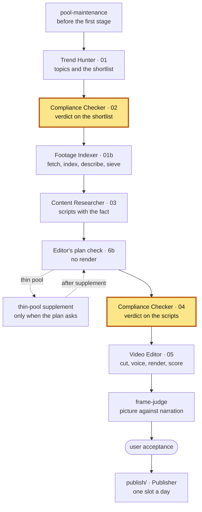

# Compliance Checker — 1.6

The factory's compliance gate: a verdict on every topic of the shortlist and on
every written script, before either costs the next stage any work.

**Part of Shorts Content Factory** ·
pin: `agents.lock.json` → `compliance-checker` @ `main`

## Contents

- [What it is](#what-it-is)
- [Place in the pipeline](#place-in-the-pipeline)
- [Input and output](#input-and-output)
- [How to run](#how-to-run)
- [How to test](#how-to-test)
- [Configuration](#configuration)
- [Limits](#limits)
- [Related](#related)
- [Version](#version)

## What it is

A Claude Code project with one skill, `compliance-checker`, and a handful of
scripts that make the decisions which must be reproducible. It is a heuristic
first-pass screen, **not legal advice**, and every file it writes says so.

It reads each topic (and later each script) for content sensitivity — the
channel's forbidden subjects: drugs, murder and the like, tragedy used for
shock, a political flashpoint, a private individual targeted — and gives one
of three verdicts: `clear`, `caution` or `review`. A `review` does not take the
topic off the batch: the video is still made, and the verdict becomes a
**publication hold** that only the user's signature lifts. The rights holder of
the material is looked up and recorded as information only; it moves no
verdict.

On the scripts it also judges the **contribution**: whether the one fact the
script adds to the story is concrete, absent from the story it is added to, and
backed by a source of its own (`channels/<channel>/stance.json`). A script
that fails is `block`ed and never reaches the Video Editor. It does not check
whether the fact is true — where facts may come from is the root's fact rule.

## Place in the pipeline



This repository is both highlighted blocks: the same skill runs twice per
batch, as the run plan's stages `compliance-shortlist` (on the Trend Hunter's
shortlist, writing `02`) and `compliance-scripts` (on the Content Researcher's
scripts, writing `04`). Where they sit and what runs before and after them is
the channel's run plan (`python3 shared/run_plan.py show <channel>` in the
root). The first pass also makes the **cut to the batch
target**: the shortlist is judged whole, then a script keeps the first topics
that fit and puts the rest in reserve, from which a later stage refills a slot
it loses.

## Input and output

Paths are relative to the batch directory `pipeline/<channel>/<batch-id>/`
of the root, unless they name a root directory.

| | file | written / read by |
|---|---|---|
| **in** | `01-trend-hunter.json` — the ordered shortlist | Trend Hunter |
| **in** | `03-content-researcher.json` — the scripts | Content Researcher |
| **in** | `channels/<channel>.json` (`scope`), `channels/<channel>/stance.json` (`verification`) | the root |
| **in** | `channels/<channel>/rights-holder-blacklist.json` — the batch channel's list of who owns what (advisory; curated `heuristic` entries and entries carrying channel-side evidence), read only through the root's `shared/channel_data.py` (`scripts/_channel_data.py`, CF-0629) | the root |
| **out** | `02-compliance-checker.json` — `results[]` (the topics that go on, held ones included), `reserve[]` (with the rows the refill from below the shortlist admitted, marked `refill`, and its refusals in `refill_refused[]`, CF-0882), the `cut` record; a flagged row names the scenes its flag rests on (`content_sensitivity_check.scenes`, CF-0846) | Footage Indexer, Content Researcher, the root's topic funnel |
| **out** | `04-compliance-checker.json` — one verdict per script, with its `contribution_check` | Video Editor, the root's funnel and triage |
| **out** | `publish/publication-holds.json` (root) — one row per held video; only the user signs it (`signature`; through the command center via `sign_hold`, CF-0687) | Publisher, the user at acceptance |
| **out** | `start` / `done` / `failed` events in `RUN_EVENTS.jsonl` | the root's `runlog` |

The scripts, in the order a pass runs them:

| script | what it does | pass |
|---|---|---|
| [`scripts/check_contribution.py`](scripts/check_contribution.py) | heuristic shape check of the added fact before the reading; exit 1 on a `block` | 04 |
| [`scripts/sensitivity_scenes.py`](scripts/sensitivity_scenes.py) | checks that every content-sensitivity flag names the scenes it rests on (`content_sensitivity_check.scenes`: the topic's `scene_id`s, or `"whole_topic"`; missing reads as the whole topic) and exits 1 on a flagged row without them; its `flagged_scenes` / `spares_scene` / `hold_spared_by_scene` are what the root asks before it lifts a hold whose flags all rest on scenes the script did not take (`flagged_scene_not_in_script`, CF-0846) | 02 |
| [`scripts/rights_holder_info.py`](scripts/rights_holder_info.py) | marks the rights-holder match `affects_verdict: false` and lowers any verdict only that match could have raised; names where a matched check came from - `evidence` (`youtube` for an entry with channel-side evidence, preferred, else `heuristic`), `blacklist_entry`, `youtube: {claims, strikes}`, `also_matched` - added beside what the pass wrote, no verdict moved (CF-0600), from the list of the batch's channel (`01-trend-hunter.json`'s `channel`, else `pipeline/<channel>/`; no channel or no list = no evidence, said; CF-0629) | 02, 04 |
| [`scripts/cut_shortlist.py`](scripts/cut_shortlist.py) | the cut to `scope.max_titles_per_batch`: publishable topics first, then held ones, in shortlist order; the rest to `reserve[]` | 02 |
| [`scripts/publication_hold.py`](scripts/publication_hold.py) | stamps the `publication_hold` on every `review` row and appends it to the ledger | 02, 04 |
| [`scripts/check_claims_gate.py`](scripts/check_claims_gate.py) | the claims gate (CF-0553): the root's claim judge (`shared/factrule/claim_judge.py` - an independent reader of the finished text and a Sonnet judge of each claim against its quote) over the words 03 holds now; a script that does not pass is blocked in `contribution_check` with `claim_unsupported`; exit 0 pass / 1 blocked / 3 could not ask / 4 a script of 03 has no row in the full 04 (keyed by topic id - 04 not done, CF-0917; the new-only `.added.json` or `--partial` keeps 0) | 04 |
| [`scripts/merge_verdicts.py`](scripts/merge_verdicts.py) | the second pass over the scripts after the frame judge refused a video (CF-0800, mode `new-only`): `pending` lists the scripts of 03 without a verdict in 04; `merge` appends the new verdicts from `04-compliance-checker.added.json`, keeps every old row byte-identical, records `merges[]`, and refuses (exit 2, nothing written) a row that would change an existing verdict | 04 |
| [`scripts/judge_below_shortlist.py`](scripts/judge_below_shortlist.py) | the compliance half of the root's refill from below the shortlist (CF-0882; run by the plan stages `reserve-below-shortlist*`, not by the skill): `judge` - a verdict on the fly with no model (the rights match as information, a machine screen of the forbidden topics over the scenes and headlines; a refusal goes to `refill_refused[]`); `admit` - the topics Trend Hunter gave a pool into `reserve[]` marked `refill`, then `sensitivity_scenes.py` and `publication_hold.py`; `cut_shortlist.py` leaves those rows out of its ranking | 02 |
| [`scripts/blooper_relaxation.py`](scripts/blooper_relaxation.py) | retired from the procedure (nothing left for it to relax); kept as the record of that decision | — |

## How to run

**Requirements.** Python 3 (standard library only) and
[Claude Code](https://docs.anthropic.com/en/docs/claude-code). The repository
lives inside the factory checkout as `agents/compliance-checker/`: the scripts
find the root by walking up from themselves (or from `FACTORY_ROOT`) and load
its `shared/runlog`, `shared/channel_ids.py` from there. No keys, no
network.

**A pass** is the skill, started in this directory by the operator session with
the batch already open:

```sh
cd shorts-content-factory/agents/compliance-checker
claude "/compliance-checker example-film <batch-id> 01-trend-hunter"       # pass 02
claude "/compliance-checker example-film <batch-id> 03-content-researcher" # pass 04
```

The skill writes the verdicts and runs the scripts above with `RUNLOG_BATCH`
exported, so each leaves its events in the batch. The procedure, the output
shape and every rule are in [`SKILL.md`](.claude/skills/compliance-checker/SKILL.md).

## How to test

```sh
python3 tests/run_tests.py                 # the suite: network off, live parts skipped
python3 tests/run_tests.py test_x.py       # only the named file(s) (also test_x); --help
python3 tests/run_tests.py --live          # only the live tests, network open
python3 tests/run_tests.py --live --list   # what --live would start, nothing run
```

Every `tests/test_*.py` runs as a script under a per-file time ceiling, in a
fresh temporary directory; a file passes only with a clean `N/N passed` line.
A test does not go to the network and does not read live data (the factory's
`docs/test-hygiene.md`, CF-0614): the plain run turns the network off past
loopback (the root's `shared/test_hygiene.py`, loaded by path; HF/transformers
offline too) and fails a file that reached for it, whatever it printed, and
keeps the rights-holder lists step 4b reads in temp roots, never the
factory's. Nothing is marked live today - the scripts are pure Python over
JSON files, so `--live` has nothing to start; a test that has to talk to the
world gets `LIVE_TEST = "why"` (or `LIVE_ENV = "SWITCH"` for a live part) and
runs only there. The tests run on synthetic batch files and temp roots; they
need the factory root around the checkout (for `shared/runlog`, the shared
guards and the README template) and read only its tracked files (the channel
config and stance, read as a contract). The guards on the suite itself:
`test_live_tree_guard.py` (no live tree, no spelled checkout in `tests/` or
`scripts/`), `test_summary_line_contract.py`, `test_timeouts.py` (no child
without a ceiling) and the runner's self-tests (`test_run_tests_*.py`:
network, ceiling, killpg EPERM, temp trees).

## Configuration

| what | where |
|---|---|
| shortlist size and the batch target the cut fills | `channels/<channel>.json` → `scope.shortlist_size`, `scope.max_titles_per_batch` |
| what counts as a contribution, the forbidden topics | `channels/<channel>/stance.json` → `position`, `the_channel_does`, `verification.compliance_checker` |
| the rights-holder list (information only) | `channels/<channel>/rights-holder-blacklist.json` (root, the channel's own) |
| the publication-hold ledger | `publish/publication-holds.json` (root) |
| the factory root, when the checkout is not inside it | env `FACTORY_ROOT` |
| the batch the scripts record events into | env `RUNLOG_BATCH` (exported by the skill) |

The values set on `example-film` today are in the root's
`docs/capabilities-1.x.md`,
section 1.

### Layout

```text
.claude/skills/compliance-checker/SKILL.md   the procedure the skill follows
scripts/                                     the reproducible decisions (table above) and the root shims
tests/                                       the suite and its runner
```

## Limits

| | |
|---|---|
| **Not legal advice.** | A heuristic screen for the obvious problems; edge cases get the verdict the checks earn, written down with the part of the text that triggered it. |
| **The rights holder moves no verdict.** | A blacklist match is recorded in full and stamped `affects_verdict: false` (CF-0420). |
| **`review` holds the upload, not the work.** | Nobody looks at a held topic during the run; its video is made, and it is not uploaded until the user signs the ledger row. |
| **The fact is not verified.** | The contribution check judges the fact's shape and source, never whether it is true. |
| **The blooper relaxation is retired here.** | With no rights-based `review` left, it has nothing to cap; the channel switch still governs the Video Editor's half. |

What is switched on, off or in warning mode across the factory, and where the
pipeline calls a human:
`docs/capabilities-1.x.md`,
sections 1.6, 2 and 5.2.

## Related

| repository | role |
|---|---|
| shorts-content-factory | channels, patterns, rotation, inserts, fact rule, score model, run accounting, contract tests, `frame-judge`, Publisher |
| trend-hunter | topics from trade-press RSS and YouTube signal; the fact probe; the shortlist |
| compliance-checker (this one) | the verdict on the shortlist and on the scripts; publication holds |
| footage-indexer | footage acquisition, shot index and descriptions, the source sieve, pool maintenance |
| content-researcher | the script: story, the fact with its source, beats and anchors |
| video-editor | the montage plan, voice, captions, inserts, render, QC and score |

Next to read: the whole pipeline order in the root's
`docs/pipeline.md`,
the fact rule in
`docs/design-rules.md`,
and how the user signs a held video in
`docs/user-acceptance.md`.

## Version

pin: `agents.lock.json` → `compliance-checker` @ `main`

The root's `agents.lock.json` pins this repository: a `release/<version>` line
of the root pins a branch (`main` here), the root's `main` pins a release tag.
History is this repository's git log and the root's
`CHANGELOG.md`.
