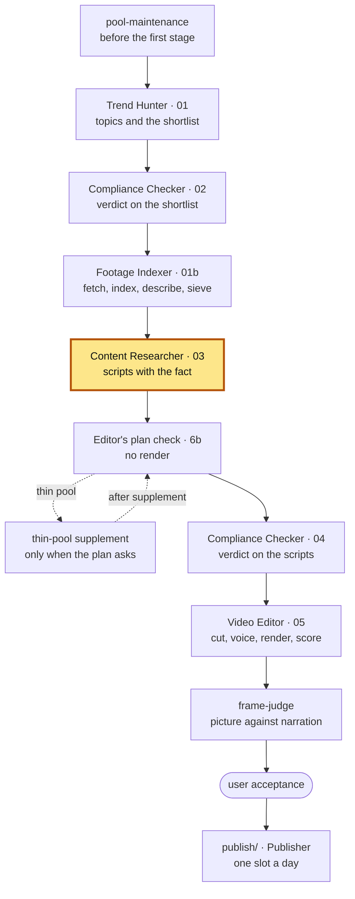

# Content Researcher — 1.6

The factory's script writer: one script per topic, retelling one story and
warming it with one concrete, sourced fact the story does not carry.

**Part of Shorts Content Factory** ·
pin: `agents.lock.json` → `content-researcher` @ `main`

## Contents

- [What it is](#what-it-is)
- [Place in the pipeline](#place-in-the-pipeline)
- [Input and output](#input-and-output)
- [How to run](#how-to-run)
- [How to test](#how-to-test)
- [Configuration](#configuration)
- [Limits](#limits)
- [Related](#related)
- [Version](#version)

## What it is

A Claude Code project with one skill, `content-researcher`, and the scripts
that hold what it writes to the channel's contracts. The skill turns the
topics that passed compliance, with the footage already fetched for them, into
scripts — hook, scene direction, commentary, payoff — in the channel's
editorial stance (`channels/<channel>/stance.json`).

The format is **"tell the story and warm it with a fact"**. The fact is of any
kind — production, box office, release, casting, reception, a scandal, news
about the people in it, a moment that was not in the script — and comes from a
source of its own, never from the coverage being retold. The Trend Hunter has
already found the candidates; this stage takes one, and a topic with no fact
is dropped before any writing (the empty-batch guard keeps at least one).

The script is written **to the footage that exists**: the pool is laid out for
the writer before a word is written, every visual anchor is held against it,
and before the script leaves this stage the Video Editor's montage plan is
built for it without a render. A plan that cannot be built gets up to three
rounds of anchor rewrites; a pool too thin for the script asks for a
thin-pool supplement. Pattern and rhythm are not chosen here — the root's
rotation assigns them.

## Place in the pipeline



This repository is the highlighted `CR` block: the skill, which runs as the
run plan's stages `content-researcher` (the scripts, `03`, with the plan check
`6b` — `scripts/plan_check_loop.py` calls the Video Editor's `plan_check.py`,
but the plan itself is the Editor's) and `content-researcher-reserve` (only
after `footage-indexer-reserve`, which runs when the plan's condition
`reserve_refill` holds: the reserve topics that took the freed slots, merged
into the `03` already written). The plan's machine stage
`plan-check-after-supplement` reruns `6b` on the pool `thin-pool-supplement`
grew, under this stage's markers; its handler `plan-check-anchor-edit` is the
anchor edit of `6b`. Where each of them sits and what runs before and after it
is the channel's run plan (`python3 shared/run_plan.py show <channel>` in the
root), not this README. The root's stop-cock closes a batch that came out of
this stage with no scripts.

## Input and output

Paths are relative to the batch directory `pipeline/<channel>/<batch-id>/`
of the root, unless they name a root directory.

| | file | written / read by |
|---|---|---|
| **in** | `01-trend-hunter.json` — topics, scenes, `fact_candidates` | Trend Hunter |
| **in** | `02-compliance-checker.json` — `results[]` and `reserve[]` | Compliance Checker |
| **in** | `01b-footage-index.json` and `shared/footage/<id>.shots.json`, `<id>.contact.jpg` | Footage Indexer |
| **in** | `channels/<channel>.json`, `channels/<channel>/stance.json`, `patterns/`, `inserts/*.json` | the root |
| **in** | the (pattern, rhythm) pair per script | the root's `rotation/rotate.py` |
| **out** | `03-content-researcher.json` — `scripts[]`, `skipped[]` with a reason code each, `warnings[]` | Compliance Checker (pass 04), Video Editor, the root's funnel and stop-cock |
| **out** | `work/supplement-requests/<topic_id>.json` — a thin-pool request | the root's supplement step, Footage Indexer |
| **out** | `start` / `done` / `failed` / `child` events in `RUN_EVENTS.jsonl` | the root's `runlog` |

The checks of step 6, each its own script under [`scripts/`](scripts/):

| check | asks |
|---|---|
| `check_narration_budget.py` | does the voice's reading of the script fit the channel's length band; one rewrite, then `held_back` - except a word over the ceiling after the rewrite: one cut-only trim (`trim_pass`, CF-0883); a sentence Kokoro would clip (`overflow_words_lost`, a chunk over 510 phonemes) is the same rewrite, punctuation-only overflow a warning (CF-0932) |
| `check_production_fact.py`, `fact_refusal.py` | is the added fact present and shaped by the contract; what happens to a topic without one |
| `already_published.py` | step 2's post-fact check (CF-0865): a topic of the same work whose fact (or source, or text) repeats a video the channel accepted before this batch leaves as `already_published`; the same fact is the fact said before or a longer fact holding a sentence, claim or quote said before (CF-0871); `same_work_unverified` marks count, a gone batch is read from `profile.read_from`, the publish card (tree or Archive zip) and the log row, and a video the user refused as `repeated_work` is held like an accepted one (CF-0928) |
| `check_source_hosts.py` | is the fact's source host one the channel accepts - run before the paid claims judge, so a topic it refuses is never judged (CF-0827) |
| `check_story_claims.py` | does every cast pair the retelling names (who plays whom) stand on the work's Wikipedia cast list, and is every cast member named in `commentary` declared - the root's rule `shared/factrule/story_claims.py` (CF-0533); a person's death / arrest / departure and the plot are `claims[]` entries judged by `check_claims.py` (CF-0556 retired the major-outlet person_event and CF-0543's plot half) |
| `shared/factrule/claims.py` (the root's, run by path; read-only) | does every checkable statement the viewer meets — narrator, on-screen wording, title, description — stand in `claims[]` on a verbatim quote of the topic's `support_text` (01, CF-0551) or on a shot of its pool that is under its words in the plan of step 6b (CF-0552); the judge of whether the quote says the claim and the refusal are CF-0553's |
| `check_claims.py` | the independent check (CF-0553, the root's `shared/factrule/claim_judge.py`): a separate model call lists every checkable claim of the finished text and each must be declared; a separate Sonnet call per declared claim, shown only the claim and its quote (or shot description), says whether it follows. One edit (struck claims taken out of the text), then the topic is refused as `claim_unsupported`; a struck claim that is the video's own fact is not struck but reworded once in its quote's words - the source's verb and qualifiers, `REWORD` (CF-0580) - and refused only if it still does not follow; before the judge, with no model call and no attempt spent, `api_demo_answer_is_fact` (CF-0690: a claim on an `api_chat`, a quote from the model's answer, the video's own fact on a `not_a_fact` piece), the mechanics of `claims.py` and `claim_subject_pronoun` (CF-0807: a claim sentence opening on It / These / That / … - name the subject), up to 3 such runs per script (`free_fixes`); after the one rewrite, when only struck claims are left, ONE edit that only deletes their sentences / graphics (`DELETE`, CF-0807 - held mechanically to a snapshot, recorded as `deletion_pass` with `removed`), then refused if it still fails; when only an undeclared statement on the hook / payoff is left, ONE edit of those sentences only (`PHRASE`, CF-0883 - held to a snapshot, recorded as `phrase_pass`; CF-0886: also a hook / payoff claim struck `claim_not_enough` that is its section's only sentence, a struck own fact only as its one rewording with the fact on screen followed); the words of the channel's attention opener formulas and a bare title with a subtitle colon are read as no claim when what is left matches a claim that followed (CF-0883, `scripts/_hook_frame.py`, `not_claims` on the record); run after the style gates (budget, production fact, hook opener, number density); `--write` records `claims_check`; in the reserve round (`researcher_refusal`) a first-pass script is `NOT OWNED (fails: …)` - said, never stamped (CF-0933); `--script-id` judges only the named scripts |
| `check_scale.py`, `scale_support_step.py` | a `scale` script's comparison: its arithmetic recomputed by the root's `validate_patterns.py check_scale_footing` and declared in `claims[]` (CF-0565); the reference's and the familiar size's numbers read off their pages through the channel's door into `<batch>/01-scale-support.json` before they are quoted - step 5, the root's `shared/factrule/scale_support.py` (CF-0673) |
| `check_demo.py` | is a `demo` script a demo (CF-0567, ExampleTech): the topic has our own recording (`evidence.footage_base`), the vendor's proof quotes stay inside the channel's `proof_quotes` cap, what the tool does on screen stands on the recording's shots, and a spoken line names the Hugging Face Space - or (CF-0690) the demo stands on an `api_chat` placed on the topic's `api_demo_record` and the voice names the model and "API" (`demo_api_not_named`); read-only, the Video Editor's `proof_quote_cap` / `demo_own_capture` gates hold the line after the plan |
| `check_graphics.py` | the graphics a script orders (CF-0689, ExampleTech's base footage, drawn by the Video Editor in Remotion): the root's `shared/own_graphic.py` - the order's shape, every number / name / date on a declared claim `where: graphic:<id>` and in its quote, a benchmark's source label, no text of the template's own - plus `graphic_not_placed` / `graphic_not_ordered` (every graphic has its anchor, every graphic anchor its order) and `graphic_on_channel_without_origin` (only a channel whose footage-origin has `own_graphic`); CF-0690: an `api_chat` held to the topic's `api_demo_record` (`api_demo_*` codes) and `api_demo_on_channel_without_origin`; read-only, the Video Editor's `own_graphic` refusal is the backstop |
| `check_proof_quotes.py` | the vendor's quotes stay quotes on every script of a channel with `proof_quotes` (CF-0774, ExampleTech; `example-tech/2026-10-16T0839Z` lost four scripts to the Video Editor's cap): each anchor's stretch of speech - or the Editor's block layout `check_block_capacity.py` recorded for this very script - is measured, a pool phrase on a vendor's clip is a quote, a graphic anchor is ours; `quote_too_long`, `too_many_quotes`, `quotes_over_video_total`, `quote_is_the_base` (the Editor's own words), each with its fix: graphics of the script's facts as the base, a quote only on the words its clip proves; read-only, the Video Editor's `proof_quote_cap` is the backstop |
| `check_own_graphic_skips.py` | is a topic the Footage Indexer kept on own graphics (`01b own_graphic_footing.kept[]`, CF-0689) refused for want of a pool - `nothing_to_check` / `thin_scene` - when it should have been written graphics-first (CF-0806); run after the file is written, and by `merge_batch_file.py` on the reserve call's fragment; `parent_decisions.py` does not borrow a parent's such refusal for a topic this batch keeps (`rule_changed`, CF-0807) |
| `check_hook_opener.py` | does the hook use an allowed opener, not too soon after its last use |
| `check_number_density.py` (`number_density.py` the stick) | how many figures the narrator says — per ten words and in one sentence (CF-0542, `measure`: a warning, never a rewrite, until the user signs the rule); `number_density.py history` prices a threshold on the channel's accepted videos |
| `check_reactions.py`, `check_sounds.py`, `check_proofs.py` | do the meme, sound and proof requests fit their layers |
| `check_reactions.py` (CF-0811) | where both meme gates are open a script carries one or two `reactions` or a `meme_none_reason` (`no_fitting_meme`, `tone`, `no_room`; `layer_off` / `pattern_forbids` stamped by `--write` where a gate is closed); each beat has ceil(3.0 s x the script's rate) words of commentary after its first word, two beats that far apart (`meme_missing`, `meme_spot_short`, `meme_beats_too_close`) |
| `check_anchor_cadence.py`, `check_anchor_coverage.py` | enough visual anchors, and can the pool picture each |
| `check_alternate_sides.py`, `check_block_capacity.py`, `check_two_sources.py` | two sides of an `alternate`, enough material per block, two sources on screen |
| `plan_check_loop.py` | step 6b: a topic under the usable-shot floor leaves as `pool_too_thin` first (the root's `thin_topic.py`, CF-0845); then can the Video Editor build the plan, with up to three rewrite rounds; before every check the fact's beat is re-anchored to the commentary and a script whose claims[] no longer quote its text waits unchecked (CF-0860); after a plan is built its shot claims are held to it - `shot_not_under_words` goes to `check_claims.py`'s ladder for that script and the run exits 1 (re-bind / anchor edit), `--final` refuses it as `claim_unsupported` (CF-0933) |

## How to run

**Requirements.** Python 3 (the scripts of this repository use the standard
library only) and [Claude Code](https://docs.anthropic.com/en/docs/claude-code).
The repository lives inside the factory checkout as `agents/content-researcher/`,
next to `agents/video-editor/`: the pool and plan checks run on the Video
Editor's own `.venv` and scripts, and the scripts load the root's
`shared/runlog`, `shared/factrule` and `shared/score` by walking up from
themselves (or from `FACTORY_ROOT`). The fact lookup reads Wikipedia through
the Wikimedia REST API; nothing else goes to the network.

**The stage** is the skill, started in this directory by the operator session
with the batch already open:

```sh
cd shorts-content-factory/agents/content-researcher
claude "/content-researcher example-film <batch-id>"
```

The skill writes the scripts and runs the checks with `RUNLOG_BATCH` exported,
so each leaves its events in the batch. No step of it waits for a person: a
missing input, a refused topic or a broken tool ends in a recorded outcome
with a reason code. The procedure, the output shape and every rule are in
[`SKILL.md`](.claude/skills/content-researcher/SKILL.md).

## How to test

```sh
python3 tests/run_tests.py                 # the suite: network off, live parts skipped
python3 tests/run_tests.py test_x.py       # only the named file(s) (also test_x); --help
python3 tests/run_tests.py --live          # only the live tests, network open
python3 tests/run_tests.py --live --list   # what --live would start
```

Every `tests/test_*.py` runs as a script under a per-file time ceiling, in a
fresh temporary directory; a file passes only with a clean `N/N passed` line.
A test does not go to the network and does not read live data (the factory's
`docs/test-hygiene.md`): the plain run turns the network off past loopback and
fails a file that reached for it, whatever it printed. The tests read
synthetic batches and frozen ones from `tests/fixtures/` (re-frozen by hand
with `tests/freeze_live_batches.py`), never the live `pipeline/`, `publish/`
or the pool, and the factory checkout only as `_runlog.factory_root()`. The
Wikipedia tests replay recorded API responses. Nothing is marked live today -
a test that has to talk to the world is marked `LIVE_TEST = "why"` (or
`LIVE_ENV = "SWITCH"` for a live part) and runs only with `--live`, so
`--live` reports no live tests. The channel's switches are read, not pinned:
the decision lives at the root beside the config. The pool and plan tests need
the factory root and the Video Editor's checkout with its `.venv` around this
one.

## Configuration

| what | where |
|---|---|
| the channel's stance: what the fact is, the voice, what the channel does not do | `channels/<channel>/stance.json` |
| length band, counted sections, the TTS-based estimator | `channels/<channel>.json` → `narration_budget` |
| hook openers and their spacing; plan-check rounds; tail after the last anchor | `channels/<channel>.json` → `content_researcher.*` |
| refusal of a topic without a fact, the empty-batch guard | `channels/<channel>.json` → `production_fact_refusal` |
| allowed patterns and the rotation | `channels/<channel>.json` → `patterns`; `patterns/`, `rotation/` (root) |
| insert layers the script may ask for | `channels/<channel>.json` → `insert_layers`; `inserts/*.json` (root) |
| where a fact may come from, its kinds | the channel's `channels/<id>/fact-sources.json` through `shared/channel_data.py` (`scripts/_channel_data.py` finds it, CF-0628), `shared/factrule/` (root) |
| the factory root, when the checkout is not inside it | env `FACTORY_ROOT` |
| the batch the checks record events into | env `RUNLOG_BATCH` (exported by the skill) |

The values set on `example-film` today are in the root's
`docs/capabilities-1.x.md`,
sections 1.2 and 1.3.

### Layout

```text
.claude/skills/content-researcher/SKILL.md   the procedure the skill follows
scripts/check_*.py                           the step-6 checks (table above)
scripts/fact_refusal.py, production_facts.py, wikipedia_api.py, fact_probe.py,
scripts/edition_check.py, already_published.py
                                             the fact: taking it, refusing a topic without one;
                                             the article must be the news's edition (CF-0812);
                                             the fact must not repeat a published video (CF-0865)
                                             (wikipedia_api.py loads the root's
                                             shared/wikipedia/wikipedia_api.py, CF-0551)
scripts/demo_base.py                         can each topic be a demo - step 2, before the
                                             rotation is asked (CF-0827)
scripts/plan_check_loop.py, plan_blocks.py, pool_layout.py
                                             the pool and the Editor's plan, before TTS
scripts/merge_batch_file.py, parent_decisions.py
                                             the second call and repeat batches
scripts/_*.py                                shims to the root's libraries and shared helpers
tests/                                       the suite, its runner and fixtures
```

## Limits

| | |
|---|---|
| **The fact is taken, not searched.** | The Trend Hunter searches the sources at selection; this stage takes one of its candidates. A topic without one is refused, not padded. |
| **Most pool checks warn, they do not refuse.** | A measurement of the pool sends no script back and drops no topic; the exceptions are the two-source gate in `enforce` and a topic with no indexed source. |
| **Rhythm is priced, not rewritten.** | The hold band, the pace floor and the block band take points off the score instead of sending the script back. |
| **The script does not choose its shape.** | Pattern and rhythm come from the rotation; the channel config says which are allowed. |
| **English only.** | The voice, the hook openers and the anchors (CLIP) are English. |

What is switched on, off or in warning mode across the factory (the
`tail_after_last_anchor` gate of this stage among them) and why:
`docs/capabilities-1.x.md`,
sections 2 and 4.4.

## Related

| repository | role |
|---|---|
| shorts-content-factory | channels, patterns, rotation, inserts, fact rule, score model, run accounting, contract tests, `frame-judge`, Publisher |
| trend-hunter | topics from trade-press RSS and YouTube signal; the fact probe; the shortlist |
| compliance-checker | the verdict on the shortlist and on the scripts; publication holds |
| footage-indexer | footage acquisition, shot index and descriptions, the source sieve, pool maintenance |
| content-researcher (this one) | the script: story, the fact with its source, beats and anchors |
| video-editor | the montage plan, voice, captions, inserts, render, QC and score |

Next to read: the fact rule and why footage is acquired before writing, in the
root's `docs/design-rules.md`;
a lost topic, a thin pool and the stop-cock after this stage, in
`docs/pipeline.md`;
the score the warnings feed, in
`docs/score-model.md`.

## Version

pin: `agents.lock.json` → `content-researcher` @ `main`

The root's `agents.lock.json` pins this repository: a `release/<version>` line
of the root pins a branch (`main` here), the root's `main` pins a release tag.
History is this repository's git log and the root's
`CHANGELOG.md`.
