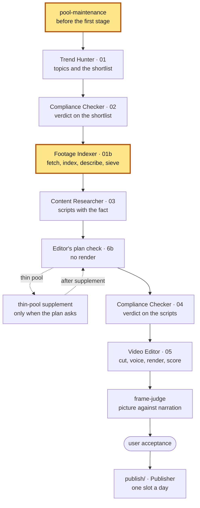

# Footage Indexer — 1.6

The factory's footage stage: it fetches the source videos for every topic,
splits them into shots, describes and sieves them, and keeps the shared pool
the scripts are written to and the videos are cut from.

**Part of Shorts Content Factory** ·
pin: `agents.lock.json` → `footage-indexer` @ `main`

## Contents

- [What it is](#what-it-is)
- [Place in the pipeline](#place-in-the-pipeline)
- [Input and output](#input-and-output)
- [How to run](#how-to-run)
- [How to test](#how-to-test)
- [Configuration](#configuration)
- [Limits](#limits)
- [Related](#related)
- [Version](#version)

## What it is

A Claude Code project with one skill, `footage-indexer`, and the scripts that
do the fetching and measuring. For each topic compliance carried onto the
batch it walks the topic's candidate videos until the topic holds **two
independent canonical sources** whose pool is deep enough, refusing
re-uploads and sources over the length ceiling on the way.

Every source is indexed once, for every video that will ever draw on it: shot
boundaries, a CLIP embedding per shot, card flags, a contact sheet, and the
cached measurements the editor's pre-cut gate reads (usability, sharpness,
the caption band). The skill then **describes every shot in plain words** and
answers two flags per shot — `burned_text` and `on_topic` — and the **source
sieve** refuses a source that is mostly somebody else's film and re-counts the
two-source and depth floors on what survived. A pool source is reused for a
topic only after Trend Hunter's checks say it is the topic's work and not
somebody else's podcast, interview or talk show (CF-0817), unless the topic is
about the person in it.

The indexer decides what footage a topic has; what the script says and which
shot goes under which phrase are decided downstream. A topic it cannot source
is written down with a reason code, never dropped silently, and its slot is
refilled from the compliance reserve.

## Place in the pipeline



This repository is both highlighted blocks. `FI` is the skill, which runs as
the run plan's stages `footage-indexer` (the main pass, writing `01b`) and
`footage-indexer-reserve` (only when the plan's condition `reserve_refill`
holds: sources for the topics that take the Researcher's refused slots), and
as its handler `supplement-describe` (descriptions for the thin-pool
supplement's new sources). `PM` is the plan's stage `pool-maintenance`, the
pool's own work before the first agent stage — checking that the cached
caption measurements are current, and repairing them when they are not — run
with this repository's scripts but accounted under its own markers. Where
each of them sits and what runs before and after it is the channel's run plan
(`python3 shared/run_plan.py show <channel>` in the root), not this README.
The thin-pool supplement is the root's step; the fetching it does
(`ingest_batch.py --supplement`) is this repository's. The Video Editor runs
this repository's `match_anchors.py` as a script inside its own stage.

## Input and output

Paths are relative to the batch directory `pipeline/<channel>/<batch-id>/`
of the root, unless they name a root directory.

| | file | written / read by |
|---|---|---|
| **in** | `01-trend-hunter.json` — topics, their candidate video ids, the pool sources already matched; an archive candidate (`nasa:<id>` / `commons:<pageid>`, its `download_url`, `licence`, `credit`, CF-0665); an own capture (`own_capture:<id>`, optionally its `capture_file`, CF-0567); a vendor clip's `channel_id` | Trend Hunter |
| **in** | `02-compliance-checker.json` — `results[]`, `reserve[]`, the `cut` | Compliance Checker |
| **in** | `03-content-researcher.json` — refused topics, for the reserve call | Content Researcher |
| **in** | `work/supplement-requests/<topic_id>.json` — a thin-pool request | Content Researcher, Trend Hunter, the root's supplement step |
| **in** | `channels/<channel>.json` — sources, ceilings, the sieve's answerer | the root |
| **in** | `channels/<channel>/footage-origin.json` (root) — the licence lists and the origins' credits a source's `rights` is read against (CF-0663); ExampleTech's `official_channels` with `role: proof_quote` (CF-0567) | the root (CF-0564) |
| **in** | an own capture's recording `own_capture-<id>.mp4` and its sidecar `own_capture-<id>.own_capture.json` — at the candidate's `capture_file`, else `<batch>/captures/`, else `shared/own-captures/` (root) (CF-0567) | the Video Editor's `capture_tool.py` |
| **out** | `01b-footage-index.json` — `fetched`, `sources_by_topic`, `skipped_topics[]` and `fetched[].rights` (licence, credit, origin, CF-0663), `failed[]` with reason codes (`licence_refused`, `licence_changed` included); an archive file under its file id `nasa-<id>` / `commons-<pageid>` with the Trend Hunter's id as `candidate_id` (CF-0665), an own capture under `own_capture-<id>` (CF-0567), `rights_exclusions`, `reserve_substitution`, `own_graphic_footing` (topics kept on own graphics, CF-0689), the sieve's record | Content Researcher, Video Editor, the root's funnel |
| **out** | `shared/footage/<id>.*` (root) — the source file, `<id>.shots.json` (shots, embeddings, descriptions, flags, cached measurements, `source_rights` — CF-0663, null for an index written before it), `index.json` (one entry per source, `rights` included; an archive file's entry adds `candidate_id`, `archive` and `licence_recheck`, CF-0665; an own capture's adds `candidate_id` and `own_capture`, CF-0567), `<id>.own_capture.json` (an own capture's recorder sidecar, CF-0567), `<id>.contact.jpg` | Content Researcher, Video Editor, `frame-judge` |
| **out** | `start` / `done` / `failed` / `child` events in `RUN_EVENTS.jsonl` | the root's `runlog` |

The main scripts (the full list, with every flag, is in
[`SKILL.md`](.claude/skills/footage-indexer/SKILL.md), section "Tools"):

| script | what it does |
|---|---|
| [`scripts/ingest_batch.py`](scripts/ingest_batch.py) | the stage: fetch and index every topic's sources, write `01b`; `--reserve-for` refills freed slots (`--after-judge`: the slots the frame judge freed, CF-0799), `--supplement` fetches a thin-pool request |
| [`scripts/fetch_footage.py`](scripts/fetch_footage.py), [`scripts/index_footage.py`](scripts/index_footage.py) | one download into the pool; one index of a file |
| [`scripts/source_sieve.py`](scripts/source_sieve.py) | refuse off-topic sources, re-count the floors, top up a topic left short |
| [`scripts/backfill_sieve_flags.py`](scripts/backfill_sieve_flags.py), [`scripts/sieve_answer_claude.py`](scripts/sieve_answer_claude.py) | the two sieve flags, answered by a headless Claude from the shot's own frame |
| [`scripts/caption_cache.py`](scripts/caption_cache.py), [`scripts/remeasure_captions.py`](scripts/remeasure_captions.py) | is the pool's caption measurement current; re-take it within a budget or set a stale crop aside (`pool-maintenance`, CF-0819: never in bulk) |
| [`scripts/match_anchors.py`](scripts/match_anchors.py) | rank a pool's shots against a phrase |

## How to run

**Requirements.** An Intel Mac, Python 3 with this repository's own `.venv`
([`requirements.txt`](requirements.txt): `torch==2.2.2` is the last x86_64
macOS wheel, which pins `transformers==4.44.2` and `numpy<2`), `ffmpeg-full`
at `/usr/local/opt/ffmpeg-full/bin/`, `node` on `PATH` for yt-dlp's challenge
solver, and the `claude` CLI logged in for the sieve's answerer. The
repository lives inside the factory checkout as `agents/footage-indexer/`,
next to `agents/video-editor/`, whose probe helpers measure the caption band.
The network is used for YouTube downloads only.

**Setup.**

```sh
cd shorts-content-factory/agents/footage-indexer
python3 -m venv .venv && .venv/bin/pip install -r requirements.txt
```

**The stage** is the skill, started in this directory by the operator session
with the batch already open; the first thing it does is a 1.3 s guard on the
pool's freshness (the check of the whole pool is `pool-maintenance`'s):

```sh
claude "/footage-indexer example-film <batch-id>"
# what the skill runs, in short:
.venv/bin/python scripts/caption_cache.py ../../shared/footage/*.shots.json
.venv/bin/python scripts/ingest_batch.py ../../pipeline/example-film/<batch-id>
.venv/bin/python scripts/source_sieve.py ../../pipeline/example-film/<batch-id>
```

Every script records its events in the batch when `RUNLOG_BATCH` is exported.
The procedure — the floors, the descriptions, when to
repair the pool and when never to — is in
[`SKILL.md`](.claude/skills/footage-indexer/SKILL.md).

## How to test

```sh
python3 tests/run_tests.py                 # the suite: network off, live parts skipped
python3 tests/run_tests.py test_x.py       # only the named file(s) (also test_x); --help
python3 tests/run_tests.py --live          # only the live parts, network open, live pool
python3 tests/run_tests.py --live --list   # what --live would start
```

The runner re-executes itself under `.venv`. Every `tests/test_*.py` runs as a
script under a per-file time ceiling, in a fresh temporary directory; a file
passes only with a clean `N/N passed` line. A test does not go to the network
and does not read live data (the factory's `docs/test-hygiene.md`): the plain
run turns the network off past loopback (Hugging Face and transformers offline
too) and fails a file that reached for it, whatever it printed, and hands every
file a temp tree. The tests run on
synthetic indexes, never on the live `pipeline/`,
`publish/`, the pool or the rights registries, and reach the factory checkout
only as `_fi_paths.factory_root()`; downloads, the YouTube duration probe and
the sieve's answerer are stubbed. What is live is the registry in
`tests/_live_monitors.py` - eight monitors that re-probe real pool media or
read the live batches (frames and the transient pool are the input, no fixture
holds them); in the suite they step aside with their reason printed, `--live`
(or `FI_TESTS_LIVE=1 python3 tests/<file>`) runs them. Some tests decode short
media and need `ffmpeg`.

## Configuration

| what | where |
|---|---|
| YouTube as a source; the length ceiling (trailer ceiling apart) | `channels/<channel>.json` → `sources.youtube.enabled`, `max_source_duration_seconds` |
| a topic with one source: warning or refusal | `channels/<channel>.json` → `footage_indexer.no_second_source.mode` |
| the sieve's answerer command and its timeout | `channels/<channel>.json` → `footage_indexer.sieve_flags_answer_cmd` |
| sources wanted, attempts per topic, the depth floor | `ingest_batch.py` flags `--sources-wanted`, `--max-per-topic`, `--pool-depth-floor` |
| the shared pool | `shared/footage/` (root) |
| the factory root, when the checkout is not inside it | env `FACTORY_ROOT` |
| the batch the scripts record events into; relabel to `pool-maintenance` | env `RUNLOG_BATCH`, `RUNLOG_STAGE` |
| index processes run side by side (default 4) | env `FOOTAGE_INDEX_WORKERS`, `ingest_batch.py --index-workers` |
| a Vision worker per index process (default on; `0` rolls back to the shared one) | env `FOOTAGE_VISION_PER_WORKER`, `ingest_batch.py --vision-per-worker` / `--no-vision-per-worker` |
| height cap of the card-text probe's frames (default 720; 0 = full resolution, the pre-CF-0740 frames) | env `FI_CARD_TEXT_MAX_H` |

**Vision per index slot (CF-0843).** Since 2026-10-21 each of the index
processes talks to a Vision worker of its own instead of queueing at the
machine-wide one (the Reel batch of 21.10 spent most of its Vision time in that
queue). Each extra worker costs ~0.85 GB, so a pass that finds less available
memory than `workers x 0.85 GB + 2 GB` runs on the shared worker instead of
swapping and prints a `WARNING`. The rollback needs no code release: export
`FOOTAGE_VISION_PER_WORKER=0` where the batch is started (the schedule), or
pass `--no-vision-per-worker` for one run; the flag wins over the env. Every
pass writes the mode it ran in into `01b-footage-index.json` - `vision_mode`
(`per_worker` | `shared`), `vision_mode_reason` (`on (...)`, `off: ...`,
`low_memory: ...`, `one_worker: ...`) and `index_workers` - so each batch is a
measurement of the switch.

The values set on `example-film` today, and the ceilings (length, attempts per
topic, the sieve's timeout, the supplement's wall clock), are in the root's
`docs/capabilities-1.x.md`,
sections 1.1, 1.5 and 4.4.

### Layout

```text
.claude/skills/footage-indexer/SKILL.md   the procedure the skill follows
scripts/ingest_batch.py, source_sieve.py  the stage and its sieve
scripts/fetch_footage.py, index_footage.py, source_fingerprint.py
                                          one download, one index, the re-upload fingerprint
scripts/archive_source.py, own_capture_source.py, source_rights.py
                                          the non-YouTube sources and every source's rights
scripts/shot_usability.py, sharpness.py, card_frame.py, screen_recording.py
                                          per-shot measurements the editor's gate reads
scripts/caption_cache.py, remeasure_*.py  freshness of the cached measurements and their repair
scripts/measure_*.py, *_replay.py         read-only measurements over frozen batches
tests/                                    the suite, its runner and fixtures
```

## Limits

| | |
|---|---|
| **The pool is never re-measured wholesale.** | A stale caption crop stops the run and is repaired under `pool-maintenance`; a stale usability stamp is safe and is not re-measured. The pool is transient: sources are deleted after their videos are published. |
| **One source per topic is a warning.** | `no_second_source` is in warning mode on `example-film`: the topic goes on with one source. |
| **A topic standing on own graphics passes the floor.** | On a channel whose `footage-origin.json` names the `own_graphic` origin (ExampleTech), a topic whose `evidence.own_graphic_footing.meets_floor` is true is never refused below the source floor (0 or 1 source, any mode): it leaves `skipped_topics[]` and is recorded as `kept on own graphics` in the report's `own_graphic_footing.kept[]` and `two_source_floor.kept_on_own_graphics` (CF-0689). Every other topic is floored as before. |
| **CLIP ranks resemblance, not usability.** | A match must pass the editor's pre-cut gate before it is cut. |
| **Card flagging is a threshold.** | High-contrast title cards are caught, subtle ones may not be; the editor's asset gate catches most of the rest. |
| **Anchors are English only.** | That is what the model was trained on. |
| **A licence the channel does not take is not fetched.** | `ingest_batch.py` refuses a candidate whose licence the Trend Hunter refused, the channel's `licences` refuse, or whose name says NC / ND / non-free, before anything is asked of YouTube (`licence_refused`, no attempt spent, CF-0663). A candidate with no licence block (ExampleFilm) is never refused on it. |
| **An archive file is fetched directly, and its licence is read again.** | A NASA or Commons candidate is downloaded from its `download_url` by `fetch_footage.py --archive-json` (`archive_source.py`): no yt-dlp; at most 500 MB and 1200 s, a video `Content-Type` and a full `Content-Length`; WebM / Ogg (and an mp4 over 1080 high) re-encoded to H.264 mp4 by `FFMPEG` / ffmpeg on PATH; the length ceiling on the candidate's length before and ffprobe's after. Before the download the licence is read again (Commons `extmetadata` judged by the root's `licence_of`, NASA `metadata.json`'s credit); a different one is `licence_changed` with both versions and no attempt spent, a re-read that does not answer decides nothing (CF-0665). |
| **An own capture is copied in, not downloaded, and is never a cam-rip.** | ExampleTech's own screen recording (`own_capture:<id>`, the Video Editor's `capture_tool.py`) is found at the candidate's `capture_file`, else `<batch>/captures/<file id>.mp4`, else the root's `shared/own-captures/`, and copied with its sidecar into the pool by `fetch_footage.py --own-capture-json` (`own_capture_source.py`): no yt-dlp, pacing, duration ceiling or sieve. Refused with nothing copied: no recording, no sidecar, a sidecar that is not an own capture's or not this file's, a length or frame size ffprobe disagrees with. Its `rights`: `licence` / `footage_origin` `own_capture`, no credit, the page and host from the sidecar. The cam-rip rule (`screen_recording.py`), the `burned_text` hard rule and the title-card flag exempt it by its kind (`source_kind: own_capture` on its shots; `usability.exempt[]`, `card_detected`), never by loosening a detector - any other source's burned text is still hard (CF-0567). |
| **A vendor's clip is a proof quote.** | A candidate whose `channel_id` is one of ExampleTech's `official_channels` with `role: proof_quote` gets `footage_origin: vendor_official`, `role: proof_quote`, `channel_id` and `channel_title` in its `rights` (CF-0567); ExampleFilm's and ExampleScience's records do not change. |
| **Downloads depend on YouTube.** | A download can still be refused by the platform; the source is then recorded `fetch_failed` and the walk goes on to the next candidate. |

What is switched on, off or in warning mode across the factory, and why:
`docs/capabilities-1.x.md`,
sections 2 and 3.

## Related

| repository | role |
|---|---|
| shorts-content-factory | channels, patterns, rotation, inserts, fact rule, score model, run accounting, contract tests, `frame-judge`, Publisher |
| trend-hunter | topics from trade-press RSS and YouTube signal; the fact probe; the shortlist |
| compliance-checker | the verdict on the shortlist and on the scripts; publication holds |
| footage-indexer (this one) | footage acquisition, shot index and descriptions, the source sieve, pool maintenance |
| content-researcher | the script: story, the fact with its source, beats and anchors |
| video-editor | the montage plan, voice, captions, inserts, render, QC and score |

Next to read: what the sieve and the pool refuse, a lost topic and a thin pool,
in the root's
`docs/pipeline.md`;
why footage is acquired before writing, in
`docs/design-rules.md`;
how `pool-maintenance` is accounted, in
`docs/run-accounting.md`.

## Version

pin: `agents.lock.json` → `footage-indexer` @ `main`

The root's `agents.lock.json` pins this repository: a `release/<version>` line
of the root pins a branch (`main` here), the root's `main` pins a release tag.
History is this repository's git log and the root's
`CHANGELOG.md`.
