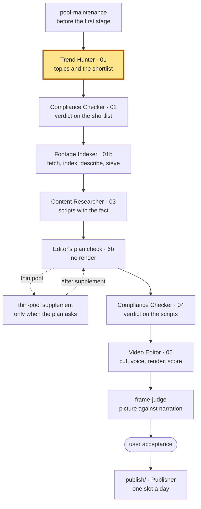

# Trend Hunter — 1.6

The factory's first stage: it finds what film and television news is popular
this week, checks that each topic has a fact to tell and footage to show, and
writes the shortlist every later stage works from.

**Part of Shorts Content Factory** ·
pin: `agents.lock.json` → `trend-hunter` @ `main`

## Contents

- [What it is](#what-it-is)
- [Place in the pipeline](#place-in-the-pipeline)
- [Input and output](#input-and-output)
- [How to run](#how-to-run)
- [How to test](#how-to-test)
- [Configuration](#configuration)
- [Limits](#limits)
- [Related](#related)
- [Version](#version)

## What it is

A Claude Code project with one skill, `trend-hunter`, and the scripts that
fetch and measure. Discovery comes from two places: the trade press's RSS
feeds (Variety, Deadline, The Hollywood Reporter, Vulture — counted by
publishing house, not by feed) and the YouTube Data API's view counts. The
scripts do the fetching and the arithmetic; the skill does the reading and the
judgement.

For each topic the stage builds a **popularity score**, a **candidate footage
list** (at least three uploads that name the work, from two kinds of shoot,
with unofficial, too-long and talk-about-the-work uploads sieved out), a
**fact probe** (the topic leaves the shortlist if no checkable fact is found)
and a look at what the shared **footage pool** already holds. The shortlist is
cut on popularity weighted by pool coverage; everything that did not make it
is written down with a reason code, and the viable rest is kept as a reserve
the later stages refill freed slots from.

It does not judge licensing or rights risk — that is the Compliance Checker's
verdict — and it does not write scripts. It runs once per call, when the
run plan's executor or the user asks for a batch, and never waits for a person: a
missing API key or a spent search quota closes the stage on the spot with a
recorded code.

## Place in the pipeline



This repository is the highlighted block `TH`, the first agent stage of a
batch. The batch is already open when it starts (the run plan's root stage
`batch-start`); it opens one itself only when run outside the plan. Where it
sits and what runs before and after it is the channel's run plan
(`python3 shared/run_plan.py show <channel>` in the root). It also does the
search half of the thin-pool supplement (`footage_candidates.py --supplement`);
fetching what it finds is the Footage Indexer's.

## Input and output

Paths are relative to the batch directory `pipeline/<channel>/<batch-id>/`
of the root, unless they name a root directory.

| | file | written / read by |
|---|---|---|
| **in** | `channels/<channel>.json` (root) — scope, feeds (each with its `use` and `ai_policy`, read through the root's `shared/channel_data.py` — CF-0634), houses, weights, thresholds, YouTube settings | the owner |
| **in** | trade-press RSS feeds and the WordPress REST API behind them | the publishers |
| **in** | YouTube Data API v3 — search, video and channel statistics | YouTube |
| **in** | Wikipedia (Wikimedia Core REST API, through the root's `shared/wikipedia/wikipedia_api.py`) and the channel's `channels/<channel>/fact-sources.json` (root, CF-0627) — where a fact and the topic's support text may come from, and the channel's kinds of fact | Wikimedia, the root |
| **in** | `shared/footage/` (root) — what the pool already holds, screened with the editor's pre-cut gate | Footage Indexer |
| **in** | `publish/acceptance-log.json`, `publish/<slug>.md` (root) — videos already made | the root's acceptance |
| **in** | `work/supplement-requests/<topic_id>.json` — a thin-pool request | Content Researcher, the root's supplement step |
| **out** | `01-trend-hunter.json` — `topics[]` (score, evidence, candidate footage, `fact_candidates`, `support_text` — CF-0551, `pool`), `skipped_topics[]` with reason codes, the reserve, `discovery.rss` telemetry, `search_quota` | Compliance Checker, Footage Indexer, Content Researcher, the root's funnel |
| **out** | `work/feeds/`, `work/footage-aliases/` — the raw fetches and the aliases a topic was searched under | this stage, the supplement |
| **out** | `start` / `done` / `failed` / `child` events in `RUN_EVENTS.jsonl` | the root's `runlog` |

The main scripts (every file, with the task that introduced it, is in
[`docs/scripts.md`](docs/scripts.md)):

| script | what it does |
|---|---|
| [`scripts/fetch_rss_news.py`](scripts/fetch_rss_news.py) | the trade-press fetch of the channel's feeds (`--channel`, refused when they break the AI-bot rule), deep enough to cover the window, under a per-feed request ceiling |
| [`scripts/fetch_youtube_signal.py`](scripts/fetch_youtube_signal.py) | YouTube search and statistics, per topic and per facet (the footage facets are the channel's `scope.footage_facets`, CF-0825) |
| [`scripts/score_candidates.py`](scripts/score_candidates.py) | the calibrated popularity scale |
| [`scripts/footage_candidates.py`](scripts/footage_candidates.py) | the candidate footage list per topic, with its sieves; `--supplement` for a thin pool; on a channel that draws its own graphics (`own_graphic` origin, ExampleTech) a topic below the floor is kept on 3 quotable facts of its support text (CF-0689) |
| [`scripts/fetch_own_capture.py`](scripts/fetch_own_capture.py) | ExampleTech's own capture: the topic's tool as a public Hugging Face Space, recorded by the Video Editor's recorder into the batch's `captures/` (CF-0567) |
| [`scripts/fetch_api_demo.py`](scripts/fetch_api_demo.py) | ExampleTech's "demo via API": the topic's own model (on the channel's `api_demo.models` list) asked one of the channel's **approved** prompts through the Gemini API free tier; the verbatim answer kept as the topic's `api_demo_record` (an `api_chat` graphic's footing, never a fact); no key, refused or rate-limited - a note, no demo (CF-0690) |
| [`scripts/api_demo_text.py`](scripts/api_demo_text.py) | the API demo's record as a `support_text` piece (`api-demo-<topic>`, `kind: api_demo_record`, `not_a_fact`) - never counted toward the own-graphics floor (CF-0690) |
| [`scripts/fact_probe_topics.py`](scripts/fact_probe_topics.py) | the fact probe and the shortlist cut on popularity × pool coverage; `--before-scoring` asks the fact before the scoring search is paid for (CF-0823) |
| [`scripts/support_text.py`](scripts/support_text.py) | the topic's support text — Wikipedia article, season, episode descriptions, TVmaze's description of an aired episode (CF-0636), Wikidata's statements of the work (CF-0637), RSS summaries of a `read_text` feed only (a `headline_only` feed chooses topics, CF-0634); `no_support_text` |
| [`scripts/source_gate.py`](scripts/source_gate.py) | the one door for a text read off Wikipedia: the outlet must be `use: read_text` and `allowed` in the channel's fact-sources list (CF-0634); the TVmaze and Wikidata clients' gate (CF-0636, CF-0637) |
| [`scripts/published_before.py`](scripts/published_before.py) | which topics repeat a video already made |
| [`scripts/no_fact_memory.py`](scripts/no_fact_memory.py) | the channel's memory of `no_fact` refusals: a candidate refused in the last `scope.no_fact_memory_days` (3) days is neither probed nor searched again (CF-0823) |
| [`scripts/thin_pool_memory.py`](scripts/thin_pool_memory.py) | the channel's memory of empty pools, read out of its own earlier batches (03 `pool_too_thin` at 0 clean shots of at least one indexed source): such a work is neither drafted nor picked by the refill for `scope.thin_pool_memory_days` (3) days unless the shared pool took in a new source for it (CF-0876) |
| [`scripts/promote_below_shortlist.py`](scripts/promote_below_shortlist.py) | step 5b for topics from below the shortlist, called by the root's refill round when the reserve is spent - feeds first, the facet run only within the day's search budget, a pooled topic back into `topics[]` marked `refill` (CF-0882) |
| [`scripts/search_quota.py`](scripts/search_quota.py) | the day's search calls spent and left |
| [`scripts/search_cache.py`](scripts/search_cache.py) | CF-0824: the channel's cache of `search.list` answers (24 h scoring, 72 h footage) - a hit is not charged to the day |

## How to run

Requirements: macOS or Linux, Python 3 with a `.venv` in this directory, a
YouTube Data API v3 key, and the factory root around this checkout (the
channel config, the pool and the run log are the root's).

```sh
cp .env.example .env          # fill in YOUTUBE_API_KEY, then: chmod 600 .env
python3 -m venv .venv
.venv/bin/pip install -r requirements.txt
claude                        # Claude Code in this directory
```

Then ask Claude to use the `trend-hunter` skill for a channel, or call it as
`/trend-hunter example-film`. Every script that calls the API takes
`YOUTUBE_API_KEY` from the environment, else from this repository's `.env`,
through [`scripts/_apikey.py`](scripts/_apikey.py); the value is never
printed. The procedure the skill follows, step by step, is
[`SKILL.md`](.claude/skills/trend-hunter/SKILL.md).

## How to test

```sh
.venv/bin/python tests/run_tests.py                 # the suite: network off, live parts skipped
.venv/bin/python tests/run_tests.py test_x.py       # only the named file(s) (also test_x); --help
.venv/bin/python tests/run_tests.py --live          # only the live tests, network open
.venv/bin/python tests/run_tests.py --live --list   # what --live would start
```

Plain-assert tests in [`tests/`](tests/), no pytest; the runner pins itself to
the repository's `.venv` and puts every file under a time ceiling. Fixtures are
real captured responses ([`tests/fixtures/README.md`](tests/fixtures/README.md)).
A test does not go to the network and does not read live data (the factory's
`docs/test-hygiene.md`): the plain run turns the network off past loopback and
fails a file that reached for it, and gives every file a temp tree. The live tests are marked and run only with `--live`:
`test_live_sources.py` (the real trades), the CLI check of
`test_output_contract.py` (`TH_OUTPUT_CONTRACT_LIVE`) and the live-tree
monitors of `tests/_live_monitors.py` (`TH_TESTS_LIVE`).

## Configuration

| what | where |
|---|---|
| what a topic may be, the popularity window, the threshold, the weights, the shortlist size | `channels/<channel>.json` → `scope.*` |
| the feeds and the publishing houses they are counted under | `channels/<channel>.json` → `sources.rss.feeds[]`, `houses` |
| YouTube as a source; the length ceiling by kind of shoot | `channels/<channel>.json` → `sources.youtube.enabled`, `max_source_duration_seconds` |
| Wikipedia as a fact source; the outlets a fact may cite | `channels/<channel>.json` → `sources.wikipedia.enabled`; `channels/<channel>/fact-sources.json` (root; outlets and `kinds`, CF-0627) |
| official channels (the channel's) and the stop words of somebody's video about the work (the rule) | `channels/<channel>/footage-origin.json` (root, CF-0627); [`config/footage_origin.json`](config/footage_origin.json) |
| the house ceiling of the RSS signal | `channels/<channel>.json` → `sources.rss.house_ceil` (CF-0627) |
| the title and channel sieve | [`config/footage_sieve.json`](config/footage_sieve.json) |
| the API key | env `YOUTUBE_API_KEY`, else `.env` here |
| the factory root, when the checkout is not inside it | env `FACTORY_ROOT` |
| the batch the scripts record events into | env `RUNLOG_BATCH` |

The values set on `example-film` today are in the root's
`docs/capabilities-1.x.md`,
section 1.1.

### Operator documentation

| document | what is in it |
|---|---|
| [`docs/sources-and-candidates.md`](docs/sources-and-candidates.md) | how deep the RSS fetch goes; the candidate floor; relevance, origin, length and title sieves; one franchise, two films |
| [`docs/selection.md`](docs/selection.md) | a video already made; the reserve refill; the topics below the shortlist later in the batch (CF-0882); why the stage never waits; the fact at selection; hype × pool; the popularity score |
| [`docs/access-stance.md`](docs/access-stance.md) | what the RSS fetch relies on, what it takes, and its request ceiling |
| [`docs/scripts.md`](docs/scripts.md) | every file of the repository and what it does |

### Layout

```text
.claude/skills/trend-hunter/SKILL.md      the procedure the skill follows
scripts/fetch_*.py                        RSS, YouTube and channel-feed fetches
scripts/score_candidates.py               the popularity scale
scripts/footage_*.py, topic_relevance.py  candidate footage, its sieves, the supplement
scripts/fact_*.py, _factrule.py           the fact probe and the fact rule
scripts/pool_*.py                         what the shared pool holds for a topic
scripts/published_before.py, search_quota.py
                                          repeats of made videos; the search quota
scripts/no_fact_memory.py                 recent no_fact refusals of the channel
scripts/promote_below_shortlist.py        step 5b for the root's refill from below the shortlist
scripts/thin_pool_memory.py               recent empty-pool refusals of the channel
config/                                   origin and sieve lists
docs/                                     operator documentation
tests/                                    the suite, its runner and fixtures
```

## Limits

| | |
|---|---|
| **No TMDB, no Reddit.** | Discovery and metadata come from RSS and YouTube only; TMDB's terms do not fit a commercial pipeline, and Reddit is deferred. |
| **Headlines, never article bodies.** | The fetch takes title, link, date and a 500-character excerpt, under its own name, within a measured request ceiling — see [`docs/access-stance.md`](docs/access-stance.md). |
| **The search quota is the day's.** | `search.list` is capped at 100 calls a day; a topic the spent day cannot pay for leaves the shortlist as `footage_evidence_quota` instead of waiting for the reset, and a missing key closes the stage as `missing_api_key_skip` — see [`docs/selection.md`](docs/selection.md). |
| **The fact probe asks two sources today.** | The Wikipedia article and the batch's own RSS posts; the other outlets on the list reach a batch only as a citation. |
| **A topic's footage is a candidate list.** | Whether a source is really usable is decided by the Footage Indexer and the editor's pre-cut gate. |

What is switched on, off or deferred across the factory, and why:
`docs/capabilities-1.x.md`,
sections 2 and 3.

## Related

| repository | role |
|---|---|
| shorts-content-factory | channels, patterns, rotation, inserts, fact rule, score model, run accounting, contract tests, `frame-judge`, Publisher |
| trend-hunter (this one) | topics from trade-press RSS and YouTube signal; the fact probe; the shortlist |
| compliance-checker | the verdict on the shortlist and on the scripts; publication holds |
| footage-indexer | footage acquisition, shot index and descriptions, the source sieve, pool maintenance |
| content-researcher | the script: story, the fact with its source, beats and anchors |
| video-editor | the montage plan, voice, captions, inserts, render, QC and score |

Next to read: what a batch is and how a stage hands over, in the root's
`docs/pipeline.md`;
the one fact rule shared with the Content Researcher, in
`docs/design-rules.md`;
how a run is accounted, in
`docs/run-accounting.md`.

## Version

pin: `agents.lock.json` → `trend-hunter` @ `main`

The root's `agents.lock.json` pins this repository: a `release/<version>` line
of the root pins a branch (`main` here), the root's `main` pins a release tag.
History is this repository's git log and the root's
`CHANGELOG.md`.
