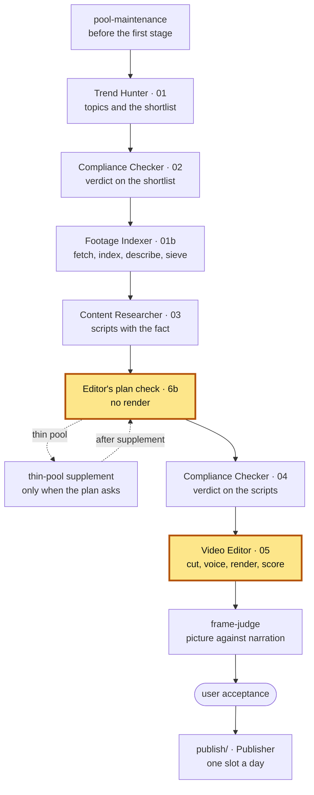

# Video Editor — 1.6

The factory's montage stage: it turns one checked script into a finished
vertical 9:16 video — voice, word timings, a shot under every phrase,
captions, inserts, music, render, quality checks and a score.

**Part of Shorts Content Factory** ·
pin: `agents.lock.json` → `video-editor` @ `main`

## Contents

- [What it is](#what-it-is)
- [Place in the pipeline](#place-in-the-pipeline)
- [Input and output](#input-and-output)
- [How to run](#how-to-run)
- [How to test](#how-to-test)
- [Configuration](#configuration)
- [Limits](#limits)
- [Related](#related)
- [Version](#version)

## What it is

A Claude Code project with one skill, `video-editor`, a Python pipeline in
`scripts/` and a [Remotion](https://www.remotion.dev/) project in `render/`.
The work is split on purpose: **ffmpeg** prepares assets and all audio,
**Remotion** composes the frames, captions and transitions and does the single
encoding pass, **Kokoro** speaks the narration in the channel's voice and
**whisper.cpp** aligns every word of it.

The stage reads the script, because a montage assembled without understanding
it puts the wrong picture under the words. Every phrase the script anchors is
resolved to a shot of the shared footage pool, cropped to the subject (macOS
Vision finds faces and salience), and passed through a **hard asset gate**
before it goes into the render plan; a block nothing could fill goes down a
ladder of answers rather than onto a filler. Proof cards, memes, the source
line and the music bed are layered in by the channel's switches. The finished
file is checked again, scored with the factory's score model, and handed to
the root's `frame-judge` with a pack of frames to look at.

It decides how the video looks and sounds; what is said is the script's, and
rights were decided twice upstream. Nothing in it knows the channel is about
television. The steps from the voice to the plan run first inside the Content
Researcher's stage (the **plan check**, no render), so a script is fitted to
its footage before it is paid for twice.

## Place in the pipeline



This repository is both highlighted blocks. `PLAN` is its plan check
(`scripts/plan_check.py check`), run by the Content Researcher for every
script before the second compliance pass: voice, length, alignment, anchors
and the render plan, with no render. `VE` is the stage itself, after the
second compliance pass: it reuses the checked plan, renders, checks and scores
the video, and writes the batch's `05` record. A rebuild of one video
(`pipeline/rebuilds/<ts>`) runs the same scripts by hand on a copied batch.

## Input and output

Paths are relative to the batch directory `pipeline/<channel>/<batch-id>/`
of the root, unless they name a root directory.

| | file | written / read by |
|---|---|---|
| **in** | `03-content-researcher.json` — the scripts: narration, beats, `visual_anchors[]`, `proofs[]`, `reactions[]` | Content Researcher |
| **in** | `04-compliance-checker.json` — which scripts are cleared | Compliance Checker |
| **in** | `01b-footage-index.json` and `shared/footage/` (root) — the topic's sources, shots, descriptions, cached measurements; each source's rights record (`fetched[].rights`, else `<id>.shots.json` `source_rights`, CF-0663) | Footage Indexer |
| **in** | `work/<slug>/plan_check.json`, `plan.json` — the plan check's verdict and plan | this repository, run by the Content Researcher |
| **in** | `channels/<channel>.json`, `patterns/`, `inserts/`, `shared/inserts/` (root) — voice, length budget, styles, insert switches, memes, loops, beds | the root |
| **in** | `channels/<channel>/footage-origin.json` (root) — whose footage is credited how; on ExampleTech also `capture_hosts` (where the factory may record a page) and `proof_quotes` (the caps on a vendor's quote), read through the root's `shared/footage_licence.py` (CF-0567) | the root |
| **in** | `pipeline/<channel>/retired-shots.json` (root) — shots already shown in a video of the channel | this stage, earlier batches |
| **out** | `work/<slug>/` — `voice.wav`, word timings, `storyboard.json`, `plan.json`, `plan.score.json`, the attempt ledger | this stage, `frame-judge` |
| **out** | `videos/<slug>.mp4` — the finished video | `frame-judge`, user acceptance, `publish/` |
| **out** | `videos/<slug>.jpg` — its preview: one 720×1280 frame of the hook, open and lit, at most 200 KB, written by `write_batch_metadata.py` after QC on a batch and a rebuild alike (CF-0674, [`scripts/video_preview.py`](scripts/video_preview.py)), and only beside an mp4 under the `<batch_dir>` it records - a live monitor that hands it a real batch's mp4 leaves that batch untouched (CF-0681) | the command centre's video API (root `api/videos.py`) |
| **out** | `05-video-editor.json` — per video: style, QC, score, inserts and their provenance, the bed, duration; `footage_credits[]` — whose judged footage is on screen, its licence and credit (CF-0664, [`scripts/footage_credits.py`](scripts/footage_credits.py)); a vendor's proof quote (`role: proof_quote` / `vendor_official`) is credited to its channel — `credit` = the rights record's `channel_title` ("OpenAI"), `credit_from: "channel_title"`, the source URL kept; a quote with no `channel_title` keeps the origin's rule (`credit: null`) and the plan notes it (CF-0686); `own_captures[]` — the factory's own recordings on screen, with their page (no credit); graphics the factory draws from the script's facts (`own_graphic`, CF-0689, [`scripts/own_graphic_plan.py`](scripts/own_graphic_plan.py), [docs/plan-and-gates.md](docs/plan-and-gates.md) «Own graphics») get no credit either and are listed in the plan's `own_graphics[]` — among them CF-0690's `api_chat`, a model's real answer through its API in our own chat, held to the call's record ([docs/plan-and-gates.md](docs/plan-and-gates.md) «A demo via API»); `proof_quote_cap` — the vendor quotes against the channel's caps (CF-0567, [`scripts/proof_quote_cap.py`](scripts/proof_quote_cap.py)) | `frame-judge`, the root's funnel and acceptance, the Publisher's card (PUB-1) |
| **out** | `own_capture-<id>.mp4` + `own_capture-<id>.own_capture.json` — a screen recording of a public page and its record, in the directory the caller names (CF-0567, [`scripts/capture_tool.py`](scripts/capture_tool.py)) | the Footage Indexer, which ingests it as `own_capture:<id>` |
| **out** | `pipeline/<channel>/retired-shots.json` (root) — the shots this batch's videos retired | the next batch |
| **out** | the frame judge's pack — `manifest.json` and contact sheets | `frame-judge` |
| **out** | `start` / `done` / `failed` / `child` events in `RUN_EVENTS.jsonl` | the root's `runlog` |

The main scripts (the full list, with every flag, is in
[`SKILL.md`](.claude/skills/video-editor/SKILL.md), section "Tools"):

| script | what it does |
|---|---|
| [`scripts/plan_check.py`](scripts/plan_check.py) | the plan check (`check`) and its reuse by the stage (`reuse`) |
| [`scripts/synthesize_voiceover.py`](scripts/synthesize_voiceover.py), [`align_words.py`](scripts/align_words.py) | the voice in the channel's profile; whisper word timings |
| [`scripts/resolve_anchors.py`](scripts/resolve_anchors.py) | a shot under every anchored phrase, the block plan, the empty-block ladder |
| [`scripts/build_render_plan.py`](scripts/build_render_plan.py) | the render plan, behind the hard asset gate and the length ceiling |
| [`scripts/render_video.py`](scripts/render_video.py) | the Remotion render, with the attempt cap |
| [`scripts/qc_render.py`](scripts/qc_render.py) | the checks on the finished file |
| [`scripts/write_batch_metadata.py`](scripts/write_batch_metadata.py) | the `05` record and the retired-shot registry (`--new-only`: adds, never rewrites - CF-0802) |
| [`scripts/repair_blocks.py`](scripts/repair_blocks.py) | the repair after the frame judge: one or two refused blocks re-picked from the topic's own pool, the video re-rendered, QC'd, its pack and its `05` row rewritten (`write_batch_metadata.py --repair`) - CF-0881 |
| [`scripts/pending_scripts.py`](scripts/pending_scripts.py) | what the `new-only` mode renders: cleared scripts `05` has no entry for (CF-0802) |
| [`scripts/frame_judge_pack.py`](scripts/frame_judge_pack.py) | the frames the judge looks at |

## How to run

Requirements: a Mac — macOS Vision does the face, salience and text detection,
and the pins below are for the Intel Mac it runs on — Python 3, Node.js, and:

- `ffmpeg-full` from Homebrew — keg-only, at `/usr/local/opt/ffmpeg-full/bin/`;
  the plain formula has no `subtitles`/libass filters;
- `whisper-cli` (whisper.cpp) on `PATH`, plus the model
  `models/ggml-base.en.bin` (not in git; whisper.cpp's
  `models/download-ggml-model.sh base.en` fetches it);
- macOS Vision through `pyobjc-framework-Vision` — face detection, attention
  saliency and text recognition, no model downloads. On an Intel Mac every
  Vision request runs on the CPU (`scripts/vision_compute.py`, CF-0711: its
  text recognition on the Intel UHD 630 hung the GPU and shut the laptop down
  on 12.10), and the render stays off `--gl=angle`; `FACTORY_GPU=off|on`
  overrides;
- the factory root around this checkout: channels, patterns, inserts, the
  footage pool and the run log are the root's.

```sh
python3 -m venv .venv
.venv/bin/pip install -r requirements.txt
(cd render && npm install)
claude                        # Claude Code in this directory
```

Then ask Claude to use the `video-editor` skill, or call it as
`/video-editor <channel> <batch-id> <script-id>`. The procedure — styles, the
attempt cap, run accounting, rebuilds, anchoring, rhythm, inserts — is
[`SKILL.md`](.claude/skills/video-editor/SKILL.md).

### Platform pins

Intel Mac, so `torch==2.2.2` is the last available x86_64 macOS wheel, which
forces `transformers==4.44.2` and `numpy<2`. Don't bump these without reading
why they are pinned.

### Working from a git worktree

`.venv/`, `models/` and `render/node_modules/` are gitignored, so a `git worktree`
under `.claude/worktrees/` has none of them, and the sibling agent
`agents/footage-indexer` is no longer one `..` away either. Nothing needs to be
symlinked or exported for that: `scripts/repo_paths.py` asks git which checkout
is the main one (a worktree's `.git` file points at it) and every path that
leaves this repo is resolved from there — the interpreter included, which is
what `tests/run_tests.py` pins the suite to. The suite gives the same number in
a worktree as in the main checkout (CF-0125).

Code *inside* the repo stays relative to the file asking for it: a worktree
exists so that its own code is what runs.

### Remotion's browser cache

Remotion keeps its headless Chrome in **`render/node_modules/.remotion/`**, per
project rather than globally. A fresh `npm install` re-downloads about 175MB,
takes roughly five minutes, and looks like a hang — the process sits near 4% CPU
because it is waiting on the network. If another Remotion project on this
machine already has it, copy the directory across instead.

## How to test

```sh
.venv/bin/python tests/run_tests.py                 # the suite: network off, live parts skipped
.venv/bin/python tests/run_tests.py test_x.py       # only the named file(s) (also test_x); --help
.venv/bin/python tests/run_tests.py --live          # only the live parts, network open, live tree
.venv/bin/python tests/run_tests.py --live --list   # what --live would start, nothing run
```

Plain-assert tests in [`tests/`](tests/), no pytest. The runner pins itself to
the repository's `.venv`, puts every file under a time ceiling and kills a
hung file's whole process group.
Some files render with Remotion and run macOS Vision, so the full suite takes
about twenty minutes; run accounting is isolated, so a test never writes into
a real batch.

A test does not go to the network and does not read live data (the factory's
`docs/test-hygiene.md`). The plain run turns the network off past loopback -
Hugging Face and transformers offline too, down to every child a file starts:
Kokoro's and CLIP's weights come from the local cache, and
`test_narration_estimate.py` says in one line which weights are missing
rather than asking the hub - and fails a file that reached for it, whatever it
printed. The tests run on synthetic plans and the frozen batches in
`tests/fixtures/` (re-frozen by hand with `tests/freeze_live_batches.py`),
never on the live `pipeline/`, `publish/`, the footage pool, the rights
registries or `notify`, and reach the factory checkout only through
`repo_paths.factory_root()` / `_runlog.factory_root()` (no home path spelled
out, in `tests/` or `scripts/` - `tests/test_live_tree_guard.py`). What is live
is the registry in `tests/_live_monitors.py`: eight monitors in seven files that read
the newest live run of the channel (its clips, voice, plan and mp4), the live
plans or the transient pool (media and the pool as it is today are the input,
no fixture holds them); in the suite they step aside with their reason
printed, `--live` (or `VE_TESTS_LIVE=1 .venv/bin/python tests/<file>`) runs
them. The regressions they once were run in the suite on synthetic media of
the same shape (`tests/_synthetic_media.py`, CF-0522). A monitor that finds
nothing to check prints `NOT_CHECKED <test>: <why>` and its file exits 3 with
`N-k/N passed, k not checked` - never green; a monitor never writes the live
tree (`untouched()` fails it if it does; CF-0558, `tests/test_live_monitor_contract.py`).

## Configuration

| what | where |
|---|---|
| the voice: Kokoro voice, speed, language | `channels/<channel>.json` → `voice_profile` |
| the length target, ceiling and band; the ending clip and end card | `channels/<channel>.json` → `narration_budget` |
| insert layers: proof, meme, sound, underlay | `channels/<channel>.json` → `insert_layers.<kind>.enabled`, and the pattern's `<kind>_layer.allowed` (root `patterns/`) |
| how long a requested meme stays up | `inserts/meme.json` (root) → `placement.min_block_seconds` (the floor; with no block at it the meme gets a span over the blocks from its beat's first word, CF-0811), `placement.max_block_seconds` (the span's ceiling); a request not placed says why in `meme_delivered[].outcome` / `reason` |
| the source line and its publishers | `channels/<channel>.json` → `video_editor.comparison_line` |
| render attempts and QC degrades per video | `channels/<channel>.json` → `video_editor.max_attempts_per_video`, `max_qc_degrades_per_video` |
| gates in warning mode; QC rules that only cost score | `channels/<channel>.json` → `video_editor.two_source_gate`, `panel_in_frame.mode`, `meme_captions.mode`, `qc_cosmetic_rules` |
| the share of pictures a plan may hold | `channels/<channel>.json` → `video_editor.max_still_share` |
| where a page may be recorded; the caps on a vendor's quote | `channels/<channel>/footage-origin.json` → `capture_hosts`, `proof_quotes`, `official_channels[].role` (root; CF-0567) |
| the music beds and their level | `channels/<channel>.json` → `video_editor.ambient.beds`, `bed_db` |
| the loudness every video is brought to (default −14 LUFS, true peak −1 dBTP) | `channels/<channel>.json` → `video_editor.loudness.target_lufs`, `true_peak_db` |
| the empty-block rung; the blooper relaxation | `channels/<channel>.json` → `assetless_block_rung.enabled`, `blooper_rights_relaxation.enabled` |
| score prices; the user's signatures and decisions on a gate's mode (the switch itself is the channel's, rows above) | `shared/gate-prices.json` (root) |
| the factory root, when the checkout is not inside it; the footage pool | env `FACTORY_ROOT`, `FOOTAGE_DIR` |
| the batch the scripts record events into | env `RUNLOG_BATCH` |

The values set on `example-film` today are in the root's
`docs/capabilities-1.x.md`,
sections 1.3–1.6 and 4.

### Operator documentation

| document | what is in it |
|---|---|
| [`docs/pipeline.md`](docs/pipeline.md) | the steps from the script to the render, the hard asset gate, the narration's length; the index of the rest |
| [`docs/narration-length.md`](docs/narration-length.md) | how long a script may be: the TTS estimate, the chunk cliff, the ceilings, the band, the pace |
| [`docs/plan-and-gates.md`](docs/plan-and-gates.md) | the anchor preflight, the gates that warn, refusals before the render, the plan built before the handoff |
| [`docs/empty-block-ladder.md`](docs/empty-block-ladder.md) | the ladder under a block that could not be filled |
| [`docs/on-screen-rules.md`](docs/on-screen-rules.md) | the blooper relaxation, the hero in the frame, inset panels, captions under memes and proof cards, the caption band |
| [`docs/frame-judge-pack.md`](docs/frame-judge-pack.md) | the pack the frame judge is handed |
| [`docs/background-bed.md`](docs/background-bed.md) | the music bed, the mix the render builds, and the loudness it ends at |
| [`docs/retired-shots.md`](docs/retired-shots.md) | one shot, one video per channel |
| [`docs/render-speed.md`](docs/render-speed.md) | what a render costs, generated from the measurement |
| [`docs/source-badge-spec.md`](docs/source-badge-spec.md) | the source-badge specification |

### Layout

```text
.claude/skills/video-editor/SKILL.md   the procedure the skill follows
scripts/                               the Python pipeline: assets, audio, anchors, gates, plan, QC, score
render/                                the Remotion project: composition, captions, render
docs/                                  operator documentation
tests/                                 the suite and its runner
work/cf0052-measure/                   the render-speed measurement and its harness
models/                                the whisper model (not in git)
.venv/                                 the Python env (not in git)
```

## Limits

| | |
|---|---|
| **One Intel Mac.** | The render numbers are this machine's and are not portable; a factory that renders back to back runs throttled. See [`docs/render-speed.md`](docs/render-speed.md). |
| **Three pool gates warn instead of refusing.** | A weak anchor, a block on the procedural rung and a single footage source go on with a warning and a score penalty. |
| **The sound layer is not executable.** | `sound` placement is written but switched off; the underlay is built and off on `example-film`. |
| **English narration only.** | The voice and the alignment model are English. |
| **QC is a gate, not taste.** | Whether the picture is about what the voice says is the `frame-judge`'s question, and the video is accepted by a person. |

What is switched on, off or in warning mode across the factory, and why:
`docs/capabilities-1.x.md`,
sections 2 and 3; render cost and ceilings, section 4.

## Related

| repository | role |
|---|---|
| shorts-content-factory | channels, patterns, rotation, inserts, fact rule, score model, run accounting, contract tests, `frame-judge`, Publisher |
| trend-hunter | topics from trade-press RSS and YouTube signal; the fact probe; the shortlist |
| compliance-checker | the verdict on the shortlist and on the scripts; publication holds |
| footage-indexer | footage acquisition, shot index and descriptions, the source sieve, pool maintenance |
| content-researcher | the script: story, the fact with its source, beats and anchors |
| video-editor (this one) | the montage plan, voice, captions, inserts, render, QC and score |

Next to read: how a stage hands over and what a lost video costs, in the root's
`docs/pipeline.md`;
the score model, in
`docs/score-model.md`;
the rule that a batch and a rebuild run on `main` only, in
`docs/running-a-batch.md`.

## Version

pin: `agents.lock.json` → `video-editor` @ `main`

The root's `agents.lock.json` pins this repository: a `release/<version>` line
of the root pins a branch (`main` here), the root's `main` pins a release tag.
History is this repository's git log and the root's
`CHANGELOG.md`.
